<div align="center">



<br/>

[](https://keycore.com.br)
[](https://www.instagram.com/keycore.hub/)
[](#)

</div>

---

## 👋 Sobre mim

Sou CEO e fundador da **KeyCore Tech Hub** e escrevo código desde a época em que fazer um Arduino responder a uma requisição AJAX era novidade. De lá para cá, o foco mudou de "fazer funcionar" para **fazer a operação de uma empresa andar sozinha**: menos planilha, menos retrabalho, menos esforço manual.

- 🧠 Desenho e construo **agentes de IA, automações e software sob medida** para empresas em crescimento
- 📡 Apaixonado por **IoT**: ESP32, sensores, MQTT, firmware e a ponte entre hardware e nuvem
- 🛡️ Especialista em **segurança da informação**, pentest e consultor em **LGPD**
- 👨‍🏫 Professor, autor e criador de conteúdo: cursos, workshops, e-books e um livro de IoT
- 🏆 Veterano de hackathons, cozinheiro de fim de semana e criador de MVPs a partir de ideias malucas
- ☕ Vivendo um equilíbrio delicado entre dieta e café

---

## 🔑 KeyCore Tech Hub

> **A KeyCore é uma parceira de transformação operacional que combina estratégia, engenharia humana, agentes de IA e software sob medida para ajudar empresas brasileiras a crescer com mais clareza, eficiência e capacidade de execução.**

Crescer não deveria significar aumentar o caos. Em 2021 a KeyCore aplicou essa tese dentro de casa, mudou o próprio modelo e passou a trabalhar com uma ideia simples: **processo bem desenhado, integrado e automatizado devolve tempo**. Entramos na rotina real, encontramos onde o tempo está sendo perdido e implementamos o que resolve, com engenharia humana e agentes de IA trabalhando juntos.

<div align="center">

| 🚀 **50+** | 🧪 **30+** | 🎓 **1.000+** |
| :---: | :---: | :---: |
| projetos entregues | startups atendidas | alunos e profissionais formados |

</div>

### Como a KeyCore destrava uma operação

| Frente | O que muda na prática |
| :--- | :--- |
| ⚙️ **Automação aplicada** | Processos repetitivos deixam de depender de esforço manual |
| 🔗 **Integrações que destravam** | Sistemas e áreas conversam, e o retrabalho entre times cai |
| 🤖 **Soluções agênticas** | Agentes de IA apoiam análise, atendimento e execução no dia a dia |
| 🧩 **Software sob medida** | Sistemas desenhados para a rotina da empresa, não para um processo genérico |
| 📊 **Inteligência operacional** | Dados e fluxos viram visibilidade e decisão |
| 🛡️ **Segurança, pentest e LGPD** · 📡 **IoT aplicada** · 🌐 **Plataformas digitais** | Capacidades complementares para fechar o ciclo |



### O ecossistema

- 🎓 **KeyCore Academy**: formação aplicada em IA, automação, IoT e segurança para profissionais e times
- 🤝 **KeyCore Community**: comunidades *IA para Empreendedores* e *IoT na Prática*
- 🧪 **Hub de Negócios**: onde aplicamos o próprio método para criar, validar e evoluir produtos internos

---

## 🚀 Open source mais recente: `wa-farm`

<a href="https://github.com/rogerin/wa-farm">
  
</a>

Ativar e manter várias contas de WhatsApp para integrações (Evolution API, WAHA, Baileys, WhatsMeow, Chatwoot) costuma exigir uma gaveta de celulares ou uma máquina com 32 GB de RAM. O **wa-farm** é um orquestrador CLI que sobe emuladores Android isolados com **7 otimizações de baixo nível** e cai para **~850 MB por instância**.

- 🪶 Imagem **AOSP pura**, sem Google Play Services, e APK oficial instalado direto da CDN
- 🖥️ Framebuffer `360x640`, 1 core, sem áudio, sem snapshots e com **modo headless**
- 🫀 **Heartbeat semanal**: liga cada conta em fila, renova a sessão multi-device de 14 dias e desliga
- 🤖 Vem com **skill para agentes de IA** (Claude Code, Codex, Gemini CLI) operarem a fazenda por comando

```bash
git clone https://github.com/rogerin/wa-farm.git && cd wa-farm
./install-skill.sh && ./wa-farm.sh bootstrap 1
```

👉 **[Repositório](https://github.com/rogerin/wa-farm)** · **[Página e calculadora de RAM](https://rogerin.github.io/wa-farm/)**

---

## 🔒 O que construo nos bastidores

A maior parte do meu trabalho vive em **repositórios privados**, de clientes e de produtos da KeyCore. Os nomes ficam de fora, mas dá para mostrar o tipo de problema que resolvemos:



| Categoria | Tipos de projeto | Stack mais comum |
| :--- | :--- | :--- |
| 🤖 **IA aplicada e agentes** | Auditoria de documentos previdenciários e contratos, extração estruturada de PDFs, agentes de atendimento e de pesquisa, texto para voz, geração de roteiros e personas | Python, FastAPI, LangChain, OpenAI, TypeScript |
| 📱 **Apps e plataformas digitais** | Mobilidade compartilhada, apoio à educação infantil, treinos e ritmo, turismo, palpites, redes e jogos sociais, live commerce | React, React Native, Capacitor, Node.js, Supabase |
| 📡 **IoT, hardware e telemetria** | Detecção de pedras em esteiras de moagem, simuladores de telemetria, monitoramento de áudio, plantas conectadas, totens de feedback urbano, firmware próprio | ESP32, C++, MicroPython, MQTT, Socket.IO, AWS IoT |
| 🏢 **SaaS de gestão vertical** | Gestão de academias e redes fitness, obras, hotelaria inteligente, equipes e escalas, agendamento, treinamentos, gestão de ideias | React, Next.js, Supabase, PostgreSQL, .NET, Flutter |
| 🏥 **Saúde e faturamento hospitalar** | Portais de recebíveis, tratamento de glosas, faturamento hospitalar e observabilidade para operação de saúde de grande porte | React, Node.js, ELK |
| 🛡️ **Segurança e pentest** | Testes de invasão em aplicações web, monitoramento de rede e laboratórios de ataque e defesa | OWASP, Python, Shell |
| 🎓 **Educação** | Cursos de IoT, MicroPython, pentest e Clean Architecture, trilhas e projetos de hackathon | Python, Node.js, ESP32 |
| 🧰 **Ferramentas internas** | Backups, uploads temporários, downloaders, geração de tokens, QR codes e utilitários de automação | Python, Shell, Docker |
| 🌐 **Sites e presença digital** | Sites institucionais, landing pages de alta conversão e guias de design | Next.js, Vite, Tailwind |

---

## 🧰 Tecnologias

**Linguagens**

[](#-tecnologias)

**Front-end e mobile**

[](#-tecnologias)

**Back-end e dados**

[](#-tecnologias)

**Infra e qualidade**

[](#-tecnologias)

**IoT, IA e automação**

[](#-tecnologias)


---

## 📈 Em números





---

## 🎓 Fora do código

- 📘 Autor do livro **IoT na Prática: Projetos Inteligentes para um Mundo Conectado** (ESP32 + AWS IoT Core)
- 🎥 Curso **IoT na Prática**: 16 h hands-on, com kit físico, MQTT, AWS IoT Core e segurança em IoT
- 🔐 E-book **Estratégias de Privacidade e Segurança Digital**, focado em proteção de dados e LGPD
- 🧑‍💼 Workshops para lideranças sobre IA, dados e decisão
- 🏆 Participante frequente de hackathons sobre cidades inteligentes, saúde e finanças

---

<div align="center">

### ☕ Mais clareza sobre sua operação pode começar com um café

[](https://keycore.com.br)

<sub>**Tecnologia que devolve tempo.**</sub>

</div>
